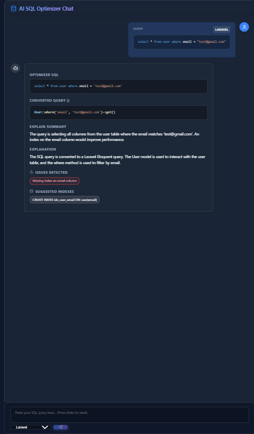

# AI-SQL-OPTIMIZER-NODE

## Description
This project optimizes SQL queries for better performance (node.js, react, redis, openAI).

## Screenshot

## Setup & How to Run
For full, detailed step-by-step instructions on setting up and running the project (Redis, Backend, and Frontend), see [SETUP_AND_RUN_GUIDE.txt](SETUP_AND_RUN_GUIDE.txt).

## Example Unoptimized Queries for Testing
To test the AI SQL Optimizer with real-world poorly optimized SQL queries (N+1 subqueries, non-SARGable conditions, wildcard scans, etc.), see [UNOPTIMIZED_SQL_EXAMPLES.txt](UNOPTIMIZED_SQL_EXAMPLES.txt).

## Presentation / PPT Prompt
For a ready-to-use prompt to generate a 6-slide MCA Mini Project presentation (for Swastika Rai) in Gemini, see [PPT_GEMINI_PROMPT.txt](PPT_GEMINI_PROMPT.txt).
